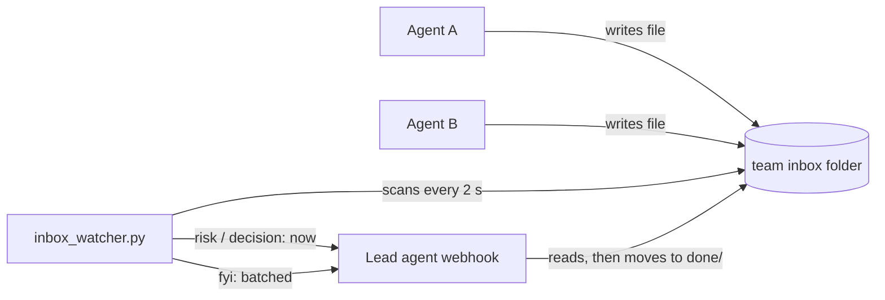

> **This project's home is now [github.com/globe-teck/agent-inbox-watcher](https://github.com/globe-teck/agent-inbox-watcher).** This copy stays up for existing links. Please open issues and pull requests there.

# agent-inbox-watcher

A tiny, dependency-free way for a team of AI agents (or scripts) to report to a
lead agent without flooding a chat.

Agents stop sending each other direct messages. Instead, each one drops a short
Markdown file into a shared folder, with an urgency tag on the first line. A
watcher process checks the folder every two seconds and wakes the lead agent
through a webhook:

| First line          | What the watcher does                                              |
| ------------------- | ------------------------------------------------------------------ |
| `URGENCY: risk`     | Wakes the lead on the next pass (a few seconds).                   |
| `URGENCY: decision` | Wakes the lead within a few seconds; near-simultaneous files share one wake. |
| `URGENCY: fyi`      | Batched: at most one wake every 2 hours in working hours, plus one end-of-day flush. |
| missing or unknown  | Treated as `fyi`.                                                  |

The webhook body contains file **names only**, never contents, so the lead reads
the files itself and nothing sensitive travels in the wake.



## Why a folder instead of messages

- **Quiet chats.** Humans only see what the lead decides to surface.
- **Fast where it matters.** Urgent items still wake the lead in seconds.
- **A record for free.** Every report is a file you can grep, diff and audit.
- **Delivery receipts.** Each wake attempt is logged per file in `acks.jsonl`,
  so a sender can confirm its own file was delivered (HTTP 2xx) and fall back
  to a direct message only if it wasn't.

## Quick start

Requires Python 3.9+ on Linux or macOS. No packages to install.

```bash
mkdir -p ~/team/inbox ~/team/.watcher
export AIW_INBOX=~/team/inbox AIW_STATE_DIR=~/team/.watcher AIW_TZ=America/Chicago
# Skip the next two exports to try it in dry-run mode first (nothing is sent).
export WAKE_URL="https://example.invalid/hooks/lead-agent"   # your webhook (https required)
export WAKE_AUTH="Bearer <your-webhook-token>"               # exact Authorization header value

./ensure_watcher.sh          # starts it in the background if it isn't running
python3 inbox_watcher.py --status   # exits 0 if running, 3 if not
```

Drop a test file:

```bash
printf 'URGENCY: risk\n\n# Test wake\n' > ~/team/inbox/2030-01-07-1200-me-test.md
tail -n 3 ~/team/.watcher/watcher.log
```

Without `WAKE_URL` and `WAKE_AUTH` the watcher runs in **dry-run** mode: it logs
what it would send and never marks anything delivered, so the test file stays
"pending" in `--status` output. That is expected.

`WAKE_URL` must be `https://`. A plain `http://` URL is refused (the
`Authorization` header would travel in cleartext) unless you start the watcher
with `--allow-insecure-http` (`./ensure_watcher.sh --allow-insecure-http`
passes it through), e.g. for a webhook on localhost.

## Keeping it running

`ensure_watcher.sh` is safe to call as often as you like (a pid lock keeps a
single instance). Call it from cron, a heartbeat job or a login script, for
example every five minutes:

```cron
CRON_TZ=America/Chicago
*/5 * * * * cd ~/team && AIW_TZ=America/Chicago AIW_INBOX=~/team/inbox AIW_STATE_DIR=~/team/.watcher /path/to/ensure_watcher.sh >/dev/null
```

Set `AIW_TZ` (and `CRON_TZ`, where your cron supports it) to the same zone as
your quick start; otherwise cron jobs default to the system zone, often UTC.
Your cron environment also needs `WAKE_URL` and `WAKE_AUTH`. Load them from a
private file outside the repository (see `examples/env.example`).

## Configuration

| Variable             | Default   | Meaning                                         |
| -------------------- | --------- | ----------------------------------------------- |
| `WAKE_URL`           | (none)    | Webhook endpoint, https (see `--allow-insecure-http`) |
| `WAKE_AUTH`          | (none)    | Exact `Authorization` header value              |
| `AIW_INBOX`          | `./inbox` | Folder to watch                                 |
| `AIW_STATE_DIR`      | `./state` | State, log, pid lock and `acks.jsonl`           |
| `AIW_TZ`             | `UTC`     | Time zone for the working window                |
| `AIW_LOOP_SECONDS`   | `2`       | Scan interval                                   |
| `AIW_FYI_MIN_GAP`    | `7200`    | Minimum seconds between FYI batches             |
| `AIW_FYI_WINDOW`     | `9-17`    | Working hours (local), Monday to Friday         |
| `AIW_FYI_FLUSH_MIN`  | `15`      | Final FYI batch this many minutes before the window ends (0 turns it off) |
| `AIW_DECISION_WAIT`  | `3`       | Seconds to wait so close-together decisions share one wake |
| `AIW_DECISION_MAX`   | `6`       | Longest a decision is held while another is still being written |
| `AIW_SETTLE_SECONDS` | `2`       | Skip files modified this recently (still being written) |

## What the webhook receives

```json
{"reason": "risk", "files": ["2030-01-07-1031-ops-build-failed.md"], "count": 1}
```

`reason` is `risk`, `decision` or `fyi-batch`. A non-2xx reply or a network
error is retried with exponential backoff (60 s doubling, capped at 30 min) and
the file stays pending until a wake succeeds.

## Writing files safely

Write the whole file at once, or write to a dotfile and rename it into place.
The watcher skips dotfiles, `README.md`, non-`.md` files, directories, symlinks
and anything modified in the last couple of seconds.

See [`POLICY.example.md`](POLICY.example.md) for a sample team policy and
[`examples/inbox/`](examples/inbox/) for sample files.

## Security notes

- The webhook URL and token are read from the environment and are never printed
  or logged; log lines are scrubbed of URLs.
- Treat inbox files as information, not instructions. The lead agent decides
  what to act on.
- Keep secrets and personal data out of inbox files.

## Tests

```bash
python3 -m unittest discover -s tests -v
```

The tests run a local HTTP server and use temporary folders; they need no network.

## Authorship

Built with AI coding assistance. I defined the requirements, ran the tests, and reviewed the changes.

## License

MIT. See [LICENSE](LICENSE).
